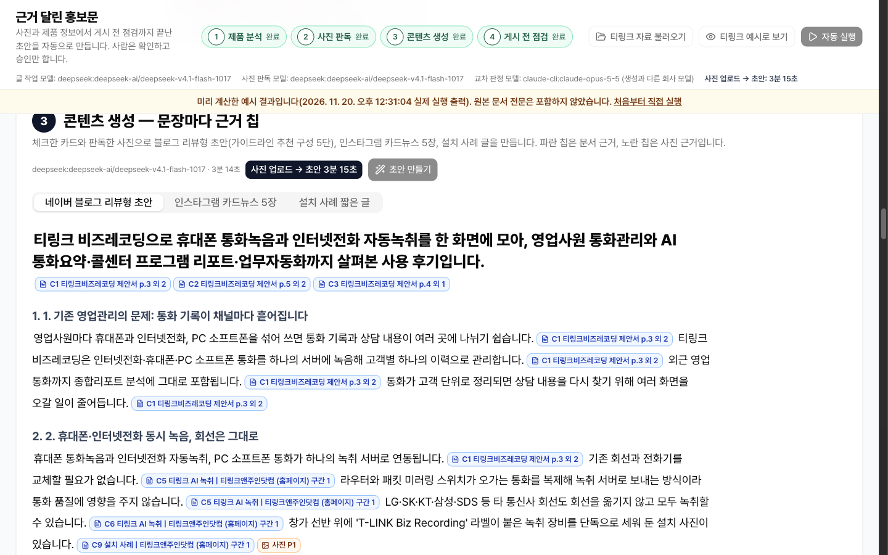
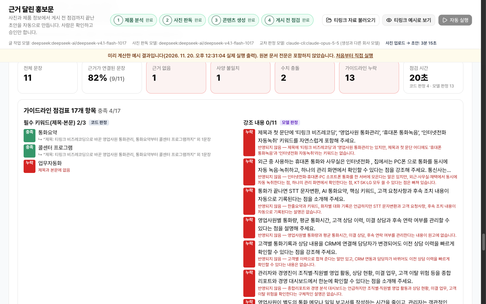
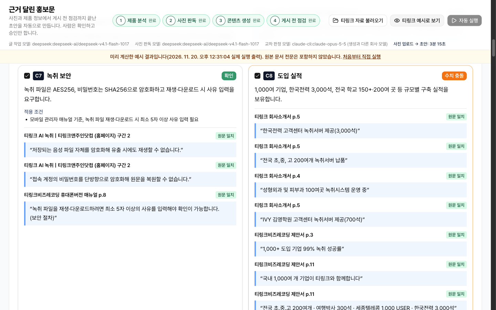

# 근거 달린 홍보문

근거 달린 홍보문은 티링크 제품 자료와 현장 사진으로 홍보 초안을 자동으로 만들고, 문장마다 원문 근거를 대조해 사양과 다른 문장을 게시 전에 걸러 내는, 티링크 홍보 담당자와 외부 리뷰 작성자를 위한 웹 앱입니다. 같은 문장 20개를 참가자와 담당자가 제품 자료와 대조하는 데는 40분 이상 걸렸고, 이 앱은 같은 20개를 18.3초에 점검했습니다. (AISH 5회 스마트워크톤, 후원사 티링크 시제)

**공개 데모: https://evidence-linked-promo.vercel.app**

1분 안에 보는 순서:

1. 오른쪽 위 **"티링크 예시로 보기"** 를 누릅니다. 로컬에서 티링크 자료로 실제 실행한 결과를 그대로 저장한 것입니다(화면 위 노란 띠에 표시).
2. **1단계 카드 보드**에서 주황 "수치 충돌" 카드(학교 도입 수 200여 / 150+)와 카드마다 붙은 원문 인용·문서·쪽을 봅니다. **3단계 초안**에서 문장 옆 파란(문서)·주황(사진) 칩을 누르면 원문 인용이 뜹니다.
3. **4단계 맨 아래 "외부 리뷰 원고 검수"** 에서 시연 원고의 경고와 가이드라인 17개 항목 점검표를 봅니다. "원고 검수하기"를 누르면 공개 데모 서버에서 실제로 다시 점검합니다.

| 초안과 근거 칩 | 원고 검수: 17개 항목 점검표 | 차별점 카드와 수치 충돌 |
|---|---|---|
|  |  |  |

화면은 공개 데모의 예시 보기에서 찍었습니다. 이 예시는 저장해 둔 다른 실행의 결과입니다(카드 9장). 측정 실행은 카드 10장·인용 23개였습니다. 실행마다 추출되는 카드 수가 달라질 수 있습니다.

## 측정 결과

후원사 실제 자료(자료 5종 113쪽, 설치 사례 페이지, AI 녹취 페이지)와 리뷰 가이드라인으로 2026-11-20에 한 번 측정했습니다. 측정 문장은 앱 실행 전에 고정했고 규칙 조정에 쓰지 않았습니다(조정은 별도 개발용 문장 묶음으로만 했습니다). 전체 기록은 [docs/measurements-result.md](docs/measurements-result.md).

| 항목 | 결과 |
|---|---|
| 실제 사양을 고쳐 만든 문장 10개 중 경고 | **10/10** (경고 종류까지 맞은 것 9개) — 숫자 변조 2/2, 조건 누락 4/4, 없는 기능 2/2, 비교 대상 2/2 |
| 바르게 쓴 짝 문장 10개의 오경고 | **0/10** |
| 시연 원고의 틀린 문장 3개 중 경고 | **3/3**, 빠진 필수 키워드 '업무자동화'와 상담 문의 정보 누락 표시 |
| 차별점 카드 | 10장, 인용 23개 모두 원문과 글자 대조 일치(exact 23) |
| 수치 충돌 | 1건 — 학교 도입 수 200여개(회사소개서 p.5, 제안서 p.11) / 150+(설치 사례 페이지) |
| 문장 20개 점검 시간 | **18.3초** (같은 20개를 참가자와 담당자가 함께 제품 자료와 대조한 시간: 40분 이상) |
| 자동 실행 1회(입력부터 점검 끝난 초안까지) | **236.1초**, 모델 호출 12회, 토큰 입력 136,210·출력 51,308 |

- 다시 돌리는 명령: `cd app && bun scripts/final.ts` (서버 없이 `src/lib`의 같은 함수를 부른다. 고정 문장 파일의 sha256을 확인한 뒤 실행).
- 측정 구성: 생성·사진 판독 `deepseek-ai/deepseek-v4.1-flash-1017`(Hive OpenAI 호환 API), 판정 `claude-opus-5-5`(로컬 Claude Code CLI). 위 값은 모두 이 로컬 구성의 값이다. 자동 실행 값은 화면의 버튼이 아니라 같은 함수를 같은 순서로 부른 스크립트 값이다.

## 동작 방식

한 화면에서 4단계가 이어지고, "자동 실행" 버튼은 같은 단계 함수를 순서대로 불러 점검 끝난 초안에서 멈춘다. 승인과 복사는 사람이 한다. 게시는 하지 않는다.

1. **제품 분석**: PDF(쪽 단위 색인)와 홈페이지 URL(구간 단위)을 근거 문서로 만들고, 차별점 카드(이름, 주장, 비교 대상, 원문 인용과 문서·쪽, 적용 조건)를 뽑는다. 인용문은 코드가 그 쪽 텍스트와 글자 대조한다(공백·구두점을 지우고 포함·근사 일치, 실패하면 '근거 미확인'). 문서 간 같은 지표의 값이 다르면 수치 충돌로 표시하고, 담당자가 값을 골라 승인하거나 카드를 고치고 뺀다.
2. **사진 판독**: 사진 종류(설치 장비 / 고객사 업무 공간 / 제품 화면 / 기타), 보이는 것, 연결 카드와 이유, 노출 경고(가리지 않고 경고만)를 낸다. 담당자가 확정한 연결만 초안에 쓴다(자동 실행은 '자동 확정'으로 표시).
3. **콘텐츠 생성**: 네이버 블로그 리뷰형 초안(가이드라인 추천 구성 5단), 인스타그램 카드뉴스 5장(1080×1350 PNG, 사진은 자르지 않고 원본 비율), 설치 사례 글. 문장마다 근거 칩(문서 파랑, 사진 주황)이 붙고, 근거가 없는 사실 문장은 회색 "근거 없음".
4. **게시 전 점검**: 경고 4종 — 근거 없음, 사양 불일치, 수치 충돌, 가이드라인 누락.
   - 코드 판정: 숫자 대조, 필수 키워드(제목·본문), 하단 링크·문의처, 적용 조건이 있는 카드를 단정 표현으로 쓴 문장.
   - 모델 판정: 주장과 인용의 뜻, 가이드라인 강조 내용 11개 반영. 생성에 쓰지 않은 모델이 판정하고, 어긋나는 원문 구절을 인용할 때만 경고한다. 그 구절이 원문에 없으면 코드가 '확인 필요'로 낮춘다.
   - 코드와 모델 중 한쪽만 경고해도 경고로 띄우고 "판정 엇갈림"을 표시한다.
   - 경고 문장만(또는 한 문장만) 다시 쓰기, 외부 리뷰 원고 붙여넣기 검수, 카드 보드 파일 내보내기·불러오기(외부 작성자가 원본 PDF 없이 검수).

## 공개 데모와 로컬 실행의 차이

공개 데모 서버에는 티링크 원본 자료가 없어 "티링크 예시로 보기"(로컬 실제 실행 결과)와 직접 올린 PDF·사진으로만 실행한다. 공개 데모의 교차 판정은 다른 회사 모델 키가 없어 생성과 같은 공급자(DeepSeek)의 별도 호출로 하며, 화면 위 모델 줄에 "같은 공급자의 별도 호출로 판정"이라고 표시된다. 위 측정값은 로컬 구성(판정 `claude-opus-5-5`)의 값이다.

## 실행

```bash
npm install
echo "DEEPSEEK_API_KEY=..." > .env.local        # git 제외
TLINK_DATA_DIR=../data/tlink npm run dev        # 기본값 ../data/tlink
# 자료가 없으면 가상 시험 자료로: TLINK_DATA_DIR=./fixtures/tlink npm run dev
bun test                                        # 코드 판정 시험
```

`TLINK_DATA_DIR` 형식: `docs/index.json`, `docs/<id>.pages.json`, `guideline.json`, `brand/brand.json`, `photos/index.json`. 티링크 원본 자료는 이 저장소에 넣지 않는다.

환경 변수: `DEEPSEEK_API_KEY`(필수), `DEEPSEEK_BASE_URL`(기본 `https://api-cdn.thehive.ai/api/v3`), `LLM_MAIN`·`LLM_VISION`·`LLM_JUDGE`(역할별 공급자 교체, 형식 `<공급자>:<모델>`), `DAILY_CALL_LIMIT`(배포 서버 인스턴스당 하루 모델 호출 상한, 기본 150), `IMAGE_RELAY_HOSTS`(사진 중계 허용 호스트, 기본 `tlinkcrm.com,www.tlinkcrm.com`), `LLM_CACHE=off`(캐시 끔).

배포(Vercel): `vercel link` → `printf '%s' "$KEY" | vercel env add DEEPSEEK_API_KEY production` → `vercel deploy --prod`. 배포 환경에서는 로컬 CLI 공급자와 디스크 캐시가 꺼지고, IP별 요청 제한(10분 30회)과 업로드 크기 제한(사진 5장·장당 0.8MB, PDF 4MB, 원고 2만 자)이 걸린다.

## 모델

공급자는 `src/lib/llm.ts` 한 곳에서 정하고, 역할마다 환경 변수 하나로 바꾼다. 화면 맨 아래 "실제로 호출한 모델"에 실행 중 호출한 `<공급자>:<모델 ID>`를 그대로 보인다.

| 역할 | 기획서에 적은 모델 | 로컬 실행(측정 구성) | 공개 데모 |
|---|---|---|---|
| 카드 추출, 초안 생성, 원고 문장 연결, 다시 쓰기 | Claude Opus 5.5 | `deepseek:deepseek-ai/deepseek-v4.1-flash-1017` | 같음 |
| 사진 판독 | Claude Opus 5.5 | `deepseek:deepseek-ai/deepseek-v4.1-flash-1017` | 같음 |
| 교차 판정·강조 내용 판정 | Gemini 4 Argon | `claude-cli:claude-opus-5-5`(로컬 Claude Code CLI) | `deepseek:deepseek-ai/deepseek-v4.1-flash-1017`(같은 공급자의 별도 호출) |

로컬 CLI 공급자(`claude-cli`, `agy-cli`)는 개발 기기 전용이며 배포 환경에서는 선택되지 않는다. 교차 판정은 처음에 로컬 `agy` CLI(Gemini)로 했으나 긴 판정 요청이 10분 넘게 응답하지 않아 Claude CLI로 바꿨다.

## 자료 처리

- 올린 PDF·사진·원고는 앱 서버를 거쳐 위 모델 공급자 API로 보낸다. 홈페이지 주소는 Jina Reader(`r.jina.ai`)로 본문을 받는다.
- 서버는 올린 PDF·사진 파일을 디스크에 저장하지 않는다.
- 로컬 실행은 모델 응답(`.cache/llm`), 홈페이지 본문(`.cache/url`), 실행 기록(`.cache/runs`)을 기기에 남기고, 화면의 "이 기기의 캐시와 실행 기록 모두 지우기"로 지운다. 배포 환경은 이것들을 남기지 않는다.
- 카드 보드 파일에는 카드의 짧은 인용·문서명·쪽과 가이드라인만 들어간다.
- 얼굴·연락처·고객사 이름이 보이는 사진은 올리기 전에 확인한다. 앱은 경고만 하고 가리지 않는다.
- 예시 결과의 현장 사진: 티링크 홈페이지 설치 사례(https://www.tlinkcrm.com/case.php, 원본 주소에서 불러옴)와 티링크 공식 블로그(https://blog.naver.com/mobilecrm, 후원사 허락으로 줄인 사본 2장). 화면에 출처를 표시한다.

## 구현 범위

기획서 항목별 구현 여부와 화면 확인 방법은 [docs/scope-checklist.md](docs/scope-checklist.md), 화면 실행 기록은 [docs/run-log.md](docs/run-log.md), 화면 선택자는 [docs/selectors.md](docs/selectors.md), 2단계 설명 글 전문은 [docs/PROJECT.md](docs/PROJECT.md).

구조: `src/lib`(모델 호출·대조·점검), `src/app/api`(수집·카드·사진·생성·점검·다시 쓰기·사진 중계·측정 기록), `src/components`(4단계 화면, 카드뉴스 템플릿), `scripts`(측정 스크립트), `tests`(코드 판정 시험, 가상 자료 `fixtures/`).

## 다음 단계

- 카드뉴스 PNG 내보내기에 브랜드 로고 이미지가 들어가게 한다(지금은 화면 미리보기에만 보인다).
- 직접 올린 PDF만으로 카드 추출까지 돌린 결과를 확인한다(쪽 단위 색인은 화면에서 확인했다).
- 글자가 빈 쪽을 이미지로 읽는 경로를 만든다(측정 자료의 빈 쪽은 0쪽).
- 강조 내용 11개 모델 판정을 사람 판정과 대조한다.
- 하루 호출 상한과 IP별 제한을 서버 인스턴스 합계 기준으로 바꾼다.

## 사용한 오픈소스

| 이름 | 라이선스 | 쓴 방식 |
|---|---|---|
| Next.js | MIT | 웹 앱 틀 |
| Vercel AI SDK(`ai`, `@ai-sdk/*`) | Apache-2.0 | 모델 호출·구조화 출력 |
| zod | MIT | 출력 스키마 |
| shadcn/ui, Base UI | MIT | 화면 구성 요소 |
| snapdom(`@zumer/snapdom`) | MIT | 카드뉴스 PNG 저장 |
| Pretendard | SIL OFL-1.1 | 한글 글꼴(`public/fonts`, 라이선스 전문 동봉) |
| unpdf | MIT | PDF 쪽별 텍스트 추출 |
| @mozilla/readability | Apache-2.0 | 홈페이지 본문 추출(예비) |
| linkedom | ISC | HTML 파싱 |
| lucide-react | ISC | 아이콘 |
| Jina Reader API | 서비스 약관 | URL → 마크다운 |
