# 화면 재설계 기록(2026 제5차 AI 스마트워크톤 트랙 A 대상 수상 기념)

이 문서는 "근거 달린 홍보문" 화면의 UX 진단, 재설계 내용, 구현 후 확인 결과를 기록한다. 기능, 동작, 측정값, API 응답 형태, `src/lib` 함수는 바꾸지 않았다. 바꾼 대상은 화면 컴포넌트, 레이아웃, 스타일, 문구 배치다.

- 작업 브랜치: `redesign`(main `641c281`에서 시작, 원격에 올리지 않음)
- 사용자 불만: "정렬이 너무 안 맞고, 한 화면에 너무 많은 게 있다."
- 화면 모드: Operate(사용자가 작업을 끝내러 온 도구 화면)
- 캡처 경로: `docs/images/redesign/`(전: `before-*`, 후: `after-*`)

## 1. 진단(재설계 전)

### 1.1 캡처와 측정

확인 조건: 개발 서버(`next dev`), 모델 호출 없음. "빈 상태"는 첫 화면, "예시"는 "티링크 예시로 보기"를 누른 상태다. 측정값은 브라우저에서 계산한 스타일과 위치를 읽어 얻었다.

| 항목 | 빈 상태 1440 | 예시 1440 | 빈 상태 390 | 예시 390 |
|---|---|---|---|---|
| 문서 전체 높이 | 2,673px | 14,886px(약 16.5화면) | 5,229px | 35,861px(약 42화면) |
| 문서 가로 폭(뷰포트 1440/390) | 1,425px | 1,425px | 1,124px(가로 넘침) | 1,124px(가로 넘침) |
| 고정 머리글 높이 | 145px | 185px | 532px | 656px(뷰포트의 78%) |
| 화면 전체 조작 요소 수 | 25 | 86 | 25 | 86 |
| 첫 화면 안 조작 요소 수 | 15 | 22 | 4 | 13 |
| 첫 화면 안 글자 덩어리의 서로 다른 왼쪽 끝 | 28 | 38 | 10 | 12 |
| 쓰인 글자 크기 종류 | 8 | 11(12.75~25.5px) | 8 | 11 |
| 쓰인 굵기 종류 | 5(400~800) | 5 | 5 | 5 |
| 서로 다른 배경색 수 | 7 | 21 | 7 | 21 |

| 상태 | 1440 | 1920 | 390 |
|---|---|---|---|
| 빈 상태 첫 화면 | 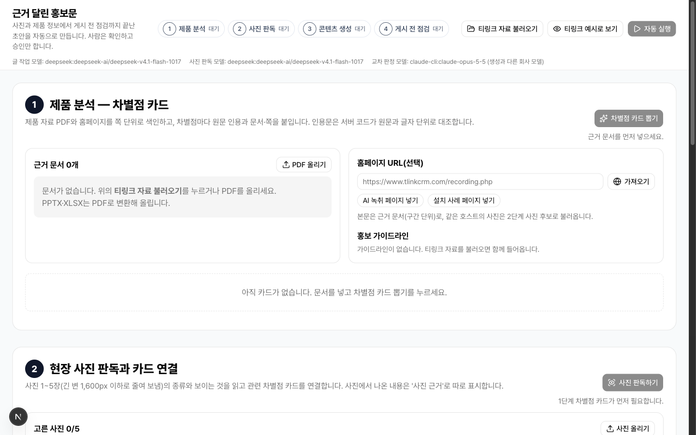 | 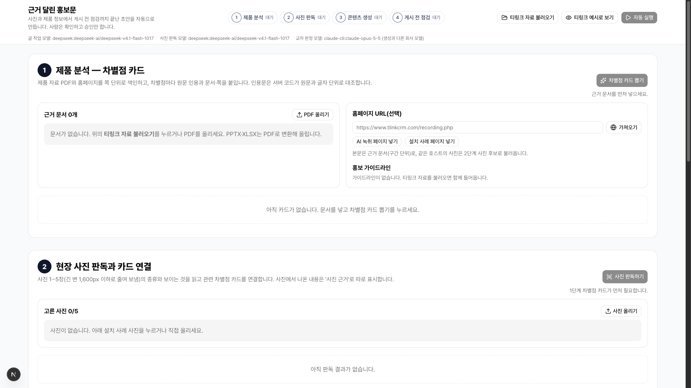 | 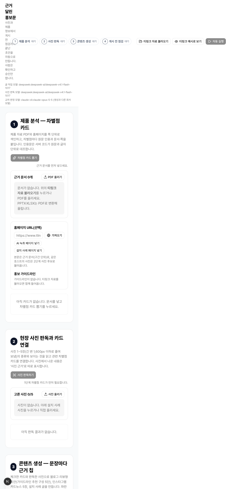 |
| 예시 첫 화면 | 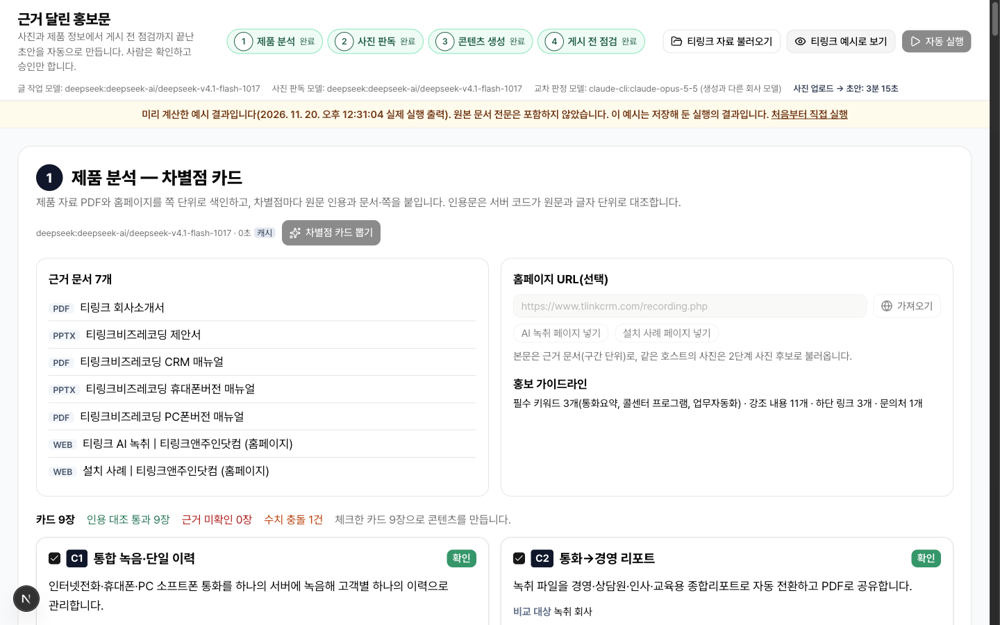 | 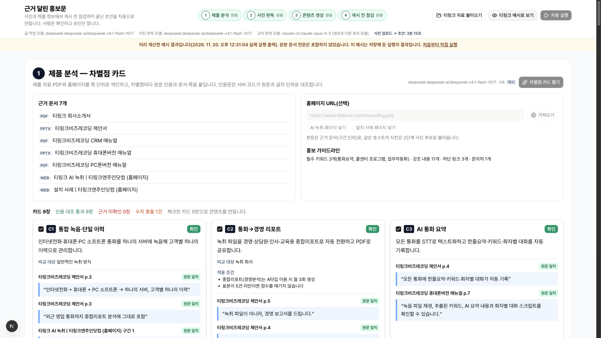 | 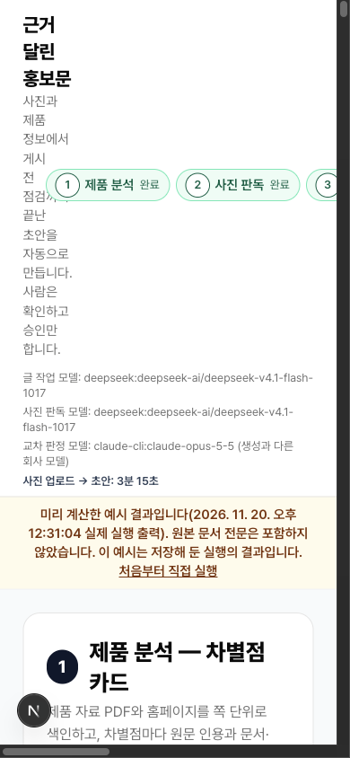 |

- 예시 전체 화면(1440, 30% 축소, 위→아래를 왼쪽→오른쪽으로 이어 붙임): 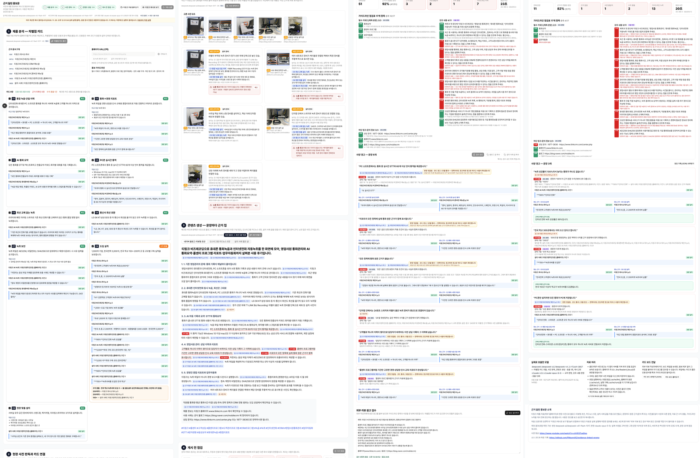
- 예시 전체 화면(1920, 25% 축소): 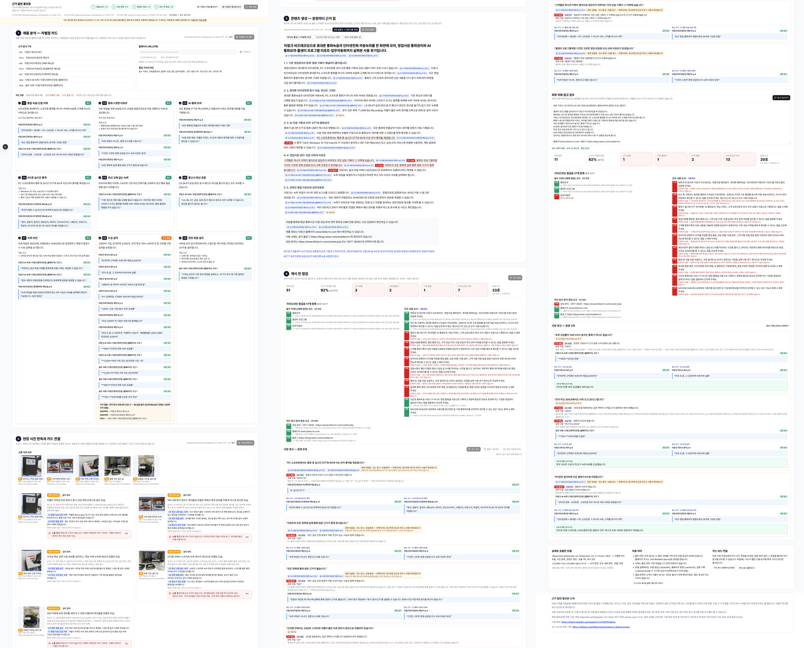
- 390 예시에서 버튼을 누른 직후(화면이 오른쪽으로 밀려 빈 영역만 보임): 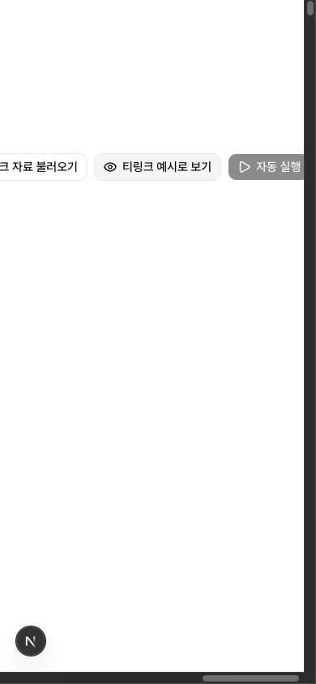
- 390 예시에서 아래로 내린 상태(고정 머리글이 화면 대부분을 덮음): 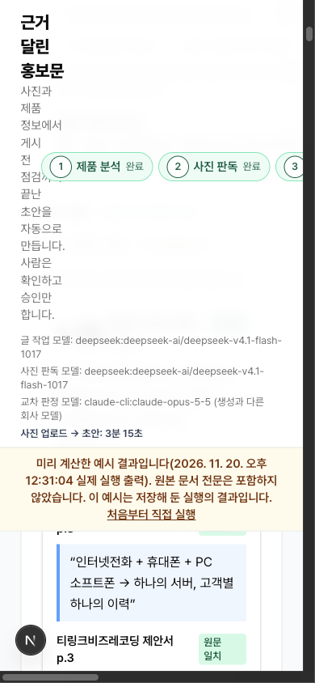
- 빈 상태 전체 화면: [1440](images/redesign/before-empty-1440-full.png) · [1920](images/redesign/before-empty-1920-full.png) · [390](images/redesign/before-empty-390-full.png)

### 1.2 주요 문제

1. **한 화면에 네 단계가 모두 펼쳐져 있다.** 4단계, 외부 원고 검수, 실행 요약, 소개가 한 페이지에 세로로 이어진다. 예시 상태에서 1440 폭은 약 16.5화면, 390 폭은 약 42화면을 내려야 끝에 닿는다. 사용자가 지금 보고 있는 단계와 다음에 볼 단계를 화면이 구분해 주지 않는다.
2. **머리글이 너무 많은 일을 한다.** 제품 이름, 세 줄짜리 설명, 단계 표시 4개, 버튼 3개, 모델 이름 3줄, 예시 안내 띠가 모두 고정 머리글에 들어 있다(1440에서 185px). 390 폭에서는 줄바꿈이 되지 않아 문서가 1,124px로 넓어지고, 고정 머리글이 532~656px이 되어 화면의 78%를 덮는다.
3. **정렬 기준이 상태마다 바뀐다.** 각 단계의 주 버튼은 오른쪽에 떠 있고, 막힌 이유 문구는 그 아래에 오른쪽 정렬로 붙는다. 모델 정보가 생기면 버튼이 왼쪽으로 밀려 위치가 달라진다(빈 상태와 예시 캡처 비교). 첫 화면에만 왼쪽 끝이 28~38개 있다.
4. **같은 무게의 주 버튼이 다섯 개다.** "차별점 카드 뽑기", "사진 판독하기", "초안 만들기", "점검하기", "원고 검수하기"가 모두 큰 주 버튼이고, 실제 첫 행동인 자료 불러오기와 예시 보기는 머리글의 보조 버튼이다. 빈 상태에서 다음 행동이 무엇인지 화면이 말해 주지 않는다.
5. **상자 안에 상자가 3~4겹이다.** 단계 상자 → 입력 상자 → 카드 상자 → 인용 상자(왼쪽 4px 색 테두리) 순으로 겹친다. 카드 C8은 인용 12개를 모두 펼쳐 한 장이 화면 두 개 높이다.
6. **글자 크기와 색이 체계 없이 늘어났다.** `0.95rem`, `1.02rem`, `1.05rem`, `1.08rem` 같은 임의 크기로 11종, 굵기 5종, 배경색 21종이 쓰였다. 상태 색(초록·빨강·주황·호박·파랑·보라)이 동시에 넓은 면적에 칠해져 어느 것이 급한지 구분되지 않는다.
7. **결과를 읽는 순서가 뒤집혀 있다.** 4단계는 수치 타일 7개 → 가이드라인 17개 항목 → 경고 목록 순이다. 사용자가 가장 먼저 봐야 할 경고 문장이 17개 항목 아래에 있다. 외부 원고 검수는 4단계 맨 아래(1440 예시에서 약 11,000px 지점)에 있어 찾기 어렵다.
8. **상태를 색으로만 구분하는 곳이 있다.** 머리글 단계 표시는 색과 작은 글자로 상태를 보이고, 수치 충돌 카드는 테두리 색만 다르다.

## 2. 레퍼런스 절차

`ui-ux-design` skill의 `reference-first.md` 절차를 따랐다.

- Notefolio CLI(`scripts/notefolio search --figma-file`)는 동작했다. 질의 "대시보드 작업 흐름 UX", "대시보드 UX", "웹 앱 UI", "AI 글쓰기 서비스 UI", "단계별 진행 UI", "SaaS 대시보드", "어드민", "관리자 페이지", "AI 서비스", "웹 대시보드", "에디터", "B2B SaaS", "업무 툴"로 찾았으나 Figma 파일을 공개한 작품은 0건이었다. `--has-figma`로 넓히면 "앱 UI"에서 2건(영화관 모바일 앱, 산소 앱 프로토타입)이 나왔으나 둘 다 모바일 소비자 앱의 `proto` 링크라 데스크톱 작업 도구의 단계 흐름을 담은 파일이 아니다. 따라서 보존할 레퍼런스가 없다(막힌 지점).
- 계약에 따라 skill에 들어 있는 `brands/` 분석을 어휘로 삼았다. Linear(왼쪽 레일 내비게이션, 목록 밀도, 상태 아이콘+글자), Vercel(무채색 바탕 위 상태 색 한정 사용, 배포 단계 목록의 상태 표시, 4px 간격 단위, 12~24px 글자 단계)에서 원칙만 가져왔고 색·로고·모양은 가져오지 않았다.
- Figma: MCP 연결이 동작해 설계 시안을 Figma 파일로 만들고 검토한 뒤 코드에 들어갔다(3.8절).

## 3. 설계

### 3.1 원칙

- 한 번에 한 단계만 보인다. 나머지 단계는 왼쪽 레일에 상태와 함께 접혀 있다.
- 모든 화면이 같은 틀을 쓴다: 제목 → 한 줄 설명 → 행동 줄 → 입력(접힘) → 결과 → 다음 단계.
- 한 화면에 주 버튼은 하나다. 다음 행동이 주 버튼이 된다.
- 결과는 "급한 것 먼저" 순서로 읽힌다: 요약 → 사람이 결정할 것(경고, 수치 충돌) → 근거 세부(펼침) → 참고 목록.
- 근거 칩(파랑=문서, 주황=사진, 회색=근거 없음)이 이 제품의 고유 표시다. 색 외에 아이콘과 글자를 함께 쓴다.

### 3.2 정보 구조와 화면 흐름

```
머리글(고정, 56px): 제품 이름 · 대상 배지 ······ [티링크 자료 불러오기] [티링크 예시로 보기] [자동 실행] 경과 시간
상태 띠(있을 때만): 예시 보기 안내 / 자동 실행 진행 / 불러오기 오류
┌ 왼쪽 레일(240px, 1024px 이상) ─┐┌ 작업 영역(최대 1200px) ─────────────────────┐
│ 1 제품 분석        ✓ 완료        ││ 선택한 단계 하나                              │
│ 2 사진 판독        ✓ 완료        ││                                              │
│ 3 콘텐츠 생성      ✓ 완료        ││                                              │
│ 4 게시 전 점검     ✓ 완료        ││                                              │
│   └ 외부 원고 검수               ││                                              │
│ ─────────                        ││                                              │
│ 실행 정보                         ││                                              │
│ 사용 모델 3줄(작은 글자)          ││                                              │
└──────────────────────────────────┘└──────────────────────────────────────────────┘
소개(서버 렌더링, 작업 영역 왼쪽 끝에 맞춤)
```

- 화면 전환은 주소 해시로 한다: `#step-1`~`#step-4`, `#paste-check`, `#run-info`. 기존 앵커 주소가 그대로 열리고 뒤로 가기가 동작한다. `/?step=check`는 자료를 불러온 뒤 외부 원고 검수 화면을 연다(기존 동작 유지).
- 예시 보기를 누르면 1단계 화면으로 간다. 자동 실행 중에는 진행 중인 단계 화면을 따라가고, 끝나면 4단계 화면을 연다. 카드 보드를 불러오면 외부 원고 검수 화면을 연다.
- 외부 원고 검수는 4단계 화면 안의 두 번째 탭이면서 레일의 하위 항목이다(진입점 두 곳).

### 3.3 화면별 와이어

**공통 틀(StepView)**

```
제목(24px/600)                                            상태: ✓ 완료
한 줄 설명(16px, 보조색, 최대 70자 폭)
모델 · 시간 · 캐시(12px)
[주 버튼] [보조 버튼]  막힌 이유(14px, 버튼 오른쪽에 같은 줄)
┌ 입력 ▸ 근거 문서 7개 · 가이드라인 있음 ─────────── 펼치기 ┐   ← 결과가 있으면 접힘
└───────────────────────────────────────────────────────────┘
진행 중: 진행 줄(스켈레톤 + 경과 시간) / 오류: 원인 + 재시도 안내 / 빈 상태: 무엇을 누르면 되는지
결과
[← 이전 단계]                                         [다음 단계: 사진 판독 →]
```

**빈 상태 첫 화면(1단계, 자료 없음)**: 결과 자리에 시작 안내 한 덩어리를 둔다. 세 갈래(예시 보기 / 티링크 자료 불러오기 / PDF·홈페이지 넣기)와 외부 원고만 점검하는 길을 나란히 적고, 첫 번째만 주 버튼으로 둔다.

**1단계 제품 분석**: 입력(근거 문서 목록, 홈페이지 주소, 홍보 가이드라인) → 요약 줄(카드 수, 인용 대조 통과, 근거 미확인, 수치 충돌, 체크한 카드) → 카드 격자(작업 영역 900px 이상 2열, 1600px 이상 화면 3열). 카드 기본 노출: 체크, 번호, 이름, 상태 배지(글자+색), 주장, 비교 대상, 적용 조건, 첫 근거의 문서·쪽, 수치 충돌 상자(결정이 필요하므로 펼침), 고치기·빼기. 펼쳐서 보기: 원문 인용 전체("근거 인용 n개 보기").

**2단계 사진 판독**: 입력(고른 사진 트레이, 사진 후보, 사진 올리기) → 판독 결과 목록(1열, 1536px 이상 2열). 한 줄 = 사진(고정 폭) + 종류 배지, 판독 문장, 보이는 것, 연결 카드(확정·해제), 노출 경고(확인 버튼).

**3단계 콘텐츠 생성**: 탭(블로그 / 카드뉴스 5장 / 설치 사례) → 근거 칩 범례 한 줄 → 본문(읽기 폭 최대 72자). 카드뉴스 탭은 PNG 미리보기 다음에 장별 문장 목록.

**4단계 게시 전 점검**: 탭(생성한 초안 점검 / 외부 리뷰 원고 검수).
- 초안 점검 읽는 순서: 요약 줄(경고 문장 수, 전체 문장, 근거 연결 비율, 경고 4종 개수, 점검 시간, 판정 주체) → 승인·복사 행동 줄 → 경고 문장 목록(문장, 근거 칩, 경고 종류·판정 주체, 엇갈림, 고쳐 쓴 제안, "이 문장만 다시 쓰기"; 원문 근거 비교는 펼침) → 확인 필요 → 가이드라인 점검표(누락 항목은 펼쳐 두고, 17개 전체는 펼쳐서 보기).
- 외부 원고 검수: 원고 입력(시연 원고 넣기, 원고 검수하기) → 점검 전에는 17개 항목 목록 → 결과(회차 상태, 요약 줄, 행동 줄, 경고 목록, 확인 필요, 점검표).

**실행 정보**: 사용 모델 3종, 자동 실행 시간, 실제로 호출한 모델, 자료 처리 안내, 카드 보드 전달. 상자 대신 구분선으로 나눈 세 구획.

**390 폭**: 머리글은 제품 이름과 배지, 그 아래 행동 버튼 줄(줄바꿈 허용)로 바뀌고 고정하지 않는다. 고정되는 것은 4칸 단계 표시줄(번호, 짧은 이름, 상태 아이콘) 하나뿐이다(높이 약 56px). 외부 원고 검수와 실행 정보는 4단계 탭과 머리글 아래 링크로 들어간다. 카드·판독 결과는 1열, 문서 가로 넘침 없음.

### 3.4 격자와 간격

- 기준 단위 4px. 쓰는 간격: 4, 8, 12, 16, 24, 32, 48px(Tailwind `1, 2, 3, 4, 6, 8, 12`).
- 묶음 안 8~12px, 묶음 사이 24px, 구획 사이 32~48px. 제목 위 간격이 아래보다 크다.
- 왼쪽 끝은 세 개만 쓴다: 레일 안쪽 끝, 작업 영역 끝(레일 + 32px), 목록 안 들여쓰기(작업 영역 + 16px).
- 작업 영역 최대 폭 1200px, 좌우 여백 32px(390 폭은 16px). 본문 읽기 폭 최대 72자.

### 3.5 글자 체계(Pretendard, 한 가족)

| 이름 | 크기/줄 높이 | 굵기 | 쓰는 곳 |
|---|---|---|---|
| caption | 12/18px | 500 | 메타 정보, 배지 |
| small | 14/22px | 400·500 | 보조 설명, 목록 세부, 버튼 |
| body | 16/26px | 400 | 본문, 카드 주장 |
| article | 17/30px | 400 | 3단계 생성 글 본문 |
| title-sm | 18/28px | 600 | 카드 이름, 구획 제목 |
| title | 24/32px | 600 | 화면 제목 |

- 루트 글자 크기를 17px에서 16px로 되돌린다(녹화용 확대 해제). 굵기는 400·500·600 세 단계, 제품 이름만 700.
- 한글은 `word-break: keep-all`, 줄 높이 1.6 이상, 자간 0.

### 3.6 색 역할(토큰)

| 역할 | 쓰는 곳 |
|---|---|
| ink / muted / border | 글자, 보조 글자(대비 4.5:1 이상), 구분선 |
| rail | 레일과 상태 띠 바탕(작업 영역보다 한 단계 짙은 무채색) |
| primary | 주 버튼, 현재 단계 표시 |
| evidence-doc(파랑) | 문서 근거 칩, 인용 |
| evidence-photo(주황) | 사진 근거 칩 |
| success / warning / danger | 완료·충족 / 확인 필요·수치 충돌 / 경고·누락·오류 |
| judge-model(보라) | 모델 판정 표시 |

상태 색은 작은 면적(배지, 아이콘, 1px 테두리, 옅은 바탕)에만 쓴다. 넓은 면을 빨강으로 칠하지 않는다. 색 4px 왼쪽 테두리는 쓰지 않는다.

### 3.7 구성 요소 목록

| 구성 요소 | 위치 | 상태 |
|---|---|---|
| TopBar(제품 이름, AwardBadge, 전역 행동, 경과 시간) | 전역 | 자동 실행 중·완료·중단 |
| StatusStrip(예시 안내, 자동 실행 진행, 불러오기 오류) | 머리글 아래 | 있을 때만 |
| StepRail / MobileStepNav | 전역 | 대기·진행 중·완료·오류(아이콘+글자) |
| StepView(제목, 설명, 메타, 행동 줄, 막힌 이유) | 각 단계 | — |
| InputPanel(접히는 입력 구획, 요약 한 줄) | 1·2단계 | 열림·접힘 |
| StatLine(요약 수치 한 줄) | 1·4단계, 원고 검수 | — |
| CardTile, EvidenceDetail, ConflictBox | 1단계 | 확인·근거 미확인·수치 충돌, 편집 중 |
| ReadingRow, PhotoThumb | 2단계 | 연결 대기·확정·자동 확정·해제, 노출 경고 확인 |
| SentenceLine, EvidenceChips, WarningTags | 3·4단계 | 경고 있음, 편집 중 |
| WarningItem, ReviewList, Checklist | 4단계 | 엇갈림, 제안 있음 |
| EmptyState / Running(진행 줄) / ErrorNote | 모든 단계 | 빈·진행 중·오류 |
| StepPager(이전·다음 단계) | 모든 단계 | 처음·끝 |

### 3.8 Figma 시안

(구현 전에 만든 시안과 검토 결과)

- 파일: 사용자 Figma 초안 폴더의 "근거 달린 홍보문 — 화면 재설계(redesign)", 페이지 "재설계 시안 v1". 주소는 저장소에 적지 않고 결과 보고에 남긴다.
- 만드는 방법: 예시 데이터(`public/demo/example.json`)의 실제 카드·경고 문장으로 정적 HTML 시안을 만들고 Figma MCP `html_to_figma`로 편집 가능한 레이어로 넣었다. 첫 시도에서 프레임이 화면 폭에 맞춰 줄어드는 문제(312px)가 있어 지우고 다시 넣었다.
- 프레임: 1440 빈 상태·시작, 1440 예시 1단계, 1440 예시 4단계, 390 예시 1단계.

| 1440 빈 상태 | 1440 예시 1단계 |
|---|---|
| 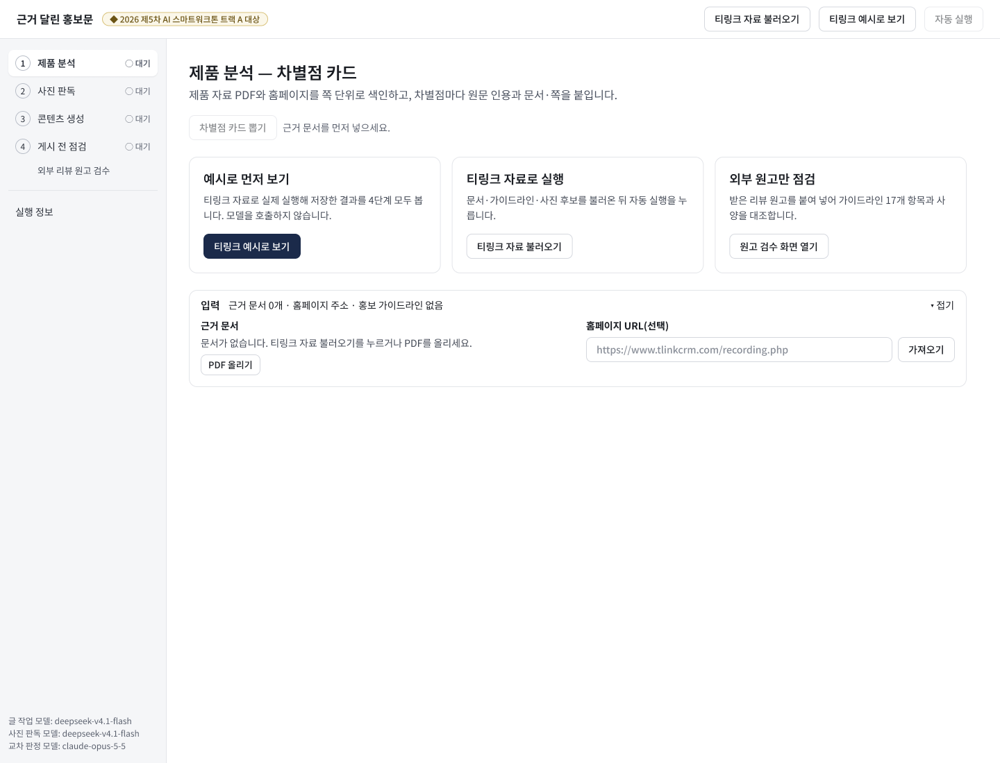 | 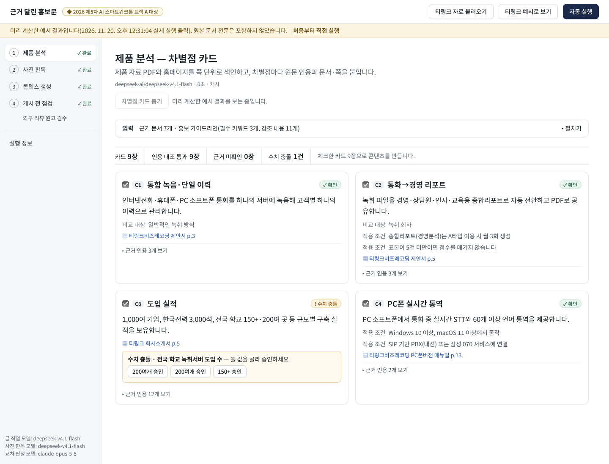 |
| **1440 예시 4단계** | **390 예시 1단계** |
| 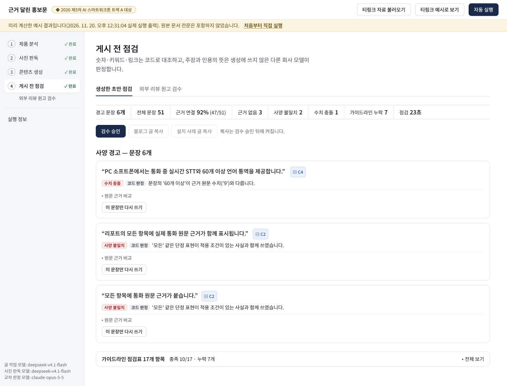 | 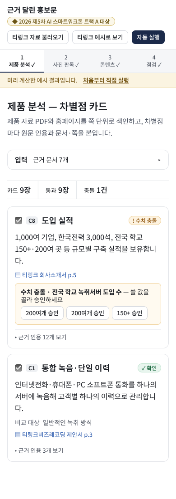 |

Figma 검토 결과(통과, 구현 때 반영할 점):

1. 정렬: 작업 영역 안 왼쪽 끝이 제목·설명·행동 줄·입력·요약·카드에서 하나로 맞는다. 목록 안 들여쓰기 하나만 추가로 생긴다.
2. 밀도: 1440 첫 화면 안에 카드 4장, 4단계는 경고 3건과 점검표 요약이 들어온다. 첫 화면의 주 버튼은 하나다.
3. 레일 아래 모델 이름: 실제 식별자(`deepseek:deepseek-ai/deepseek-v4.1-flash-1017`)는 시안보다 길다. 240px 레일에서 줄바꿈되도록 글자 단위 줄바꿈을 허용한다.
4. 빈 상태: 시작 안내의 세 갈래 중 "예시로 먼저 보기"만 주 버튼으로 둔다. 머리글의 같은 버튼과 겹치지만 첫 실행 안내이므로 유지한다.
5. 390: 4칸 단계 표시줄과 접힌 입력 구획으로 첫 화면에 제목·설명·요약·카드 1장 반이 들어온다. 고정 영역은 단계 표시줄 하나다.

### 3.9 바뀌는 것 요약

1. 네 단계를 한 페이지에 쌓던 구조를 "왼쪽 레일 + 한 번에 한 단계" 구조로 바꾼다(주소 해시로 전환, 뒤로 가기 동작).
2. 머리글을 56px 한 줄로 줄이고 대상 배지를 넣는다. 모델 이름은 레일 아래와 실행 정보 화면으로, 예시 안내와 자동 실행 진행은 머리글 아래 상태 띠로 옮긴다.
3. 모든 단계 화면을 같은 틀(제목 → 설명 → 행동 줄 → 접히는 입력 → 결과 → 이전·다음)로 맞추고, 주 버튼과 막힌 이유를 같은 왼쪽 끝에 둔다.
4. 카드의 원문 인용, 경고의 원문 비교, 가이드라인 17개 전체 목록을 펼쳐서 보는 정보로 옮긴다. 결정이 필요한 수치 충돌과 경고 문장은 펼쳐 둔다.
5. 4단계 읽는 순서를 요약 → 승인·복사 → 경고 문장 → 확인 필요 → 점검표로 바꾸고, 외부 원고 검수를 4단계 탭과 레일 하위 항목으로 꺼낸다.
6. 글자 크기 6단계, 굵기 3단계, 간격 4px 단위, 상태 색 역할을 토큰으로 정리한다(루트 17px → 16px).
7. 390 폭: 가로 넘침을 없애고, 고정 영역을 4칸 단계 표시줄(약 56px) 하나로 줄인다.
8. 빈 상태에 시작 안내(예시 보기 / 티링크 자료 / 외부 원고만 점검)를 두고, 각 단계에 빈·진행 중·오류 상태를 같은 모양으로 둔다.

## 4. 구현과 확인

(구현 후 작성)
